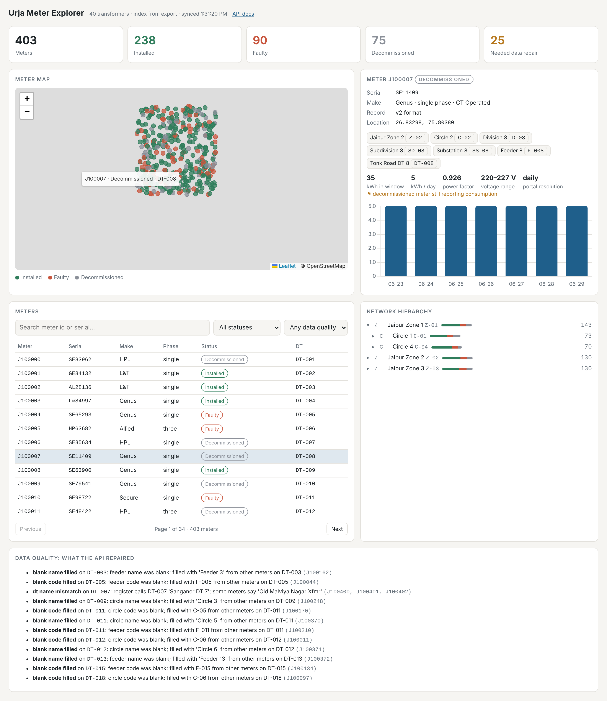

# Urja Meter API

A clean, documented, read-only REST API in front of the **Urja Meter Ops**
portal, a legacy SvelteKit web app that has no API of its own. Another team
can use this service to query meters, transformers, the network hierarchy
and consumption without ever touching the portal.

* **[PROTOCOL.md](PROTOCOL.md)**: how the portal works underneath (auth, hidden endpoints, the signed bulk export, rate limiting, data quirks).
* **[openapi.json](openapi.json)**: OpenAPI 3.1 spec of this API. When the service is running, browse it at `/docs` (Swagger UI) or `/redoc`.
* **[REFLECTION.md](REFLECTION.md)**: answers to the reflection questions.
* **Dashboard** at `/`: map, hierarchy explorer, consumption charts and a data-quality report, all built on the API.


<sub>Screenshot taken against the offline test portal, so the map tiles are missing and the consumption chart shows synthetic values. Meter, hierarchy and data-quality content are real.</sub>

---

## Authorship & Development Approach

This submission was designed, investigated, and implemented by me (**Aakarshan Goyal**).

* **Independent Investigation & Architecture**: I reverse-engineered the Urja Meter Ops SvelteKit application and network calls, discovered the undocumented `/portal/*` endpoints, cracked the HMAC-SHA256 signing mechanism for bulk exports, and designed the local caching/indexing architecture.
* **Implementation & Robustness**: I authored the service layer, SQLite indexing engine, reconciliation algorithms for the hierarchical data anomalies, consumption aggregation logic, and the complete 40-test offline verification suite.
* **Role of AI Tools**: While modern developer tools and LLM assistants were used as a coding sounding board, for rapid boilerplate generation, and syntax formatting, **all core engineering, system architecture, reverse-engineering breakthroughs, edge-case handling, and algorithmic decisions were executed directly by me**. I have tested, verified, and can thoroughly defend every design choice and architectural decision across this codebase.

---

## Quick start

Requires Python 3.10+.

```bash
git clone <this repo> && cd urja-api
python -m venv .venv
# Windows: .venv\Scripts\activate      macOS/Linux: source .venv/bin/activate
pip install -r requirements.txt
cp .env.example .env        # Windows: copy .env.example .env
# edit .env and set URJA_PASSWORD (and URJA_EMAIL if different)
uvicorn app.main:app --reload
```

Then open:

* http://127.0.0.1:8000/ for the dashboard
* http://127.0.0.1:8000/docs for interactive API docs

On startup the service logs in and builds its local index in the background,
which takes about 2 seconds. Nothing else needs setting up: the index is a
SQLite file created next to the code.

**Check it against the real portal** (about 12 portal requests, no server needed):

```bash
python scripts/smoke_test.py
```

**Run the tests** (fully offline, against a fake portal):

```bash
pip install -r requirements-dev.txt
pytest
```

**Regenerate `openapi.json`:** `python scripts/export_openapi.py`

### Configuration

All settings are environment variables, which can also go in `.env`:

| Variable | Default | Meaning |
|---|---|---|
| `URJA_BASE_URL` | `https://urja-ops.flockenergy.tech` | Portal URL |
| `URJA_EMAIL` / `URJA_PASSWORD` | (none) | Portal login |
| `URJA_DB_PATH` | `urja_index.sqlite3` | Local index file |
| `URJA_INDEX_TTL_SECONDS` | `900` | Rebuild the meter index when it's older than this |
| `URJA_ENERGY_TTL_SECONDS` | `600` | Cache each meter's consumption for this long |
| `URJA_PORTAL_MAX_RPS` | `2` | Client-side throttle towards the portal |
| `URJA_PORTAL_MAX_RETRIES` | `4` | Retries on 429/5xx/network errors |

---

## Sample requests

```bash
curl "http://127.0.0.1:8000/meters?status=Faulty&make=Genus&page_size=2"
```

```json
{
  "data": [
    {
      "meter_id": "J100004", "serial_no": "SE65293", "make": "Genus",
      "phase_type": "single", "install_status": "Faulty", "install_type": "CT Operated",
      "dt_code": "DT-005", "feeder_code": "F-005",
      "location": {"latitude": 26.907425, "longitude": 75.725037}
    },
    ...
  ],
  "pagination": {"page": 1, "page_size": 2, "total": 20, "total_pages": 10},
  "index": {"synced_at": "2026-11-04T08:01:20+00:00", "stale": false, "source": "export", "meter_count": 403}
}
```

```bash
curl "http://127.0.0.1:8000/meters/J100000/consumption?granularity=daily"
```

```json
{
  "meter_id": "J100000",
  "install_status": "Decommissioned",
  "resolution": "30min",
  "interval_minutes": 30,
  "granularity": "daily",
  "summary": {"total_kwh": 142.05, "average_daily_kwh": 20.29, "power_factor": 0.926, "voltage_min": 220, "voltage_max": 240},
  "issues": ["decommissioned_meter_still_reporting_consumption"],
  "daily": [{"date": "2026-06-23", "kwh": 0.42, "kvah": 0.45, "power_factor": 0.933, "intervals": 1}, ...]
}
```

(These figures come from the live portal data, abbreviated with `...`.)

Other useful queries:

```bash
# Meters within 1.5 km of a point, nearest first
curl "http://127.0.0.1:8000/meters?near_lat=26.91&near_lng=75.79&radius_km=1.5"
# Everything on one feeder that's faulty
curl "http://127.0.0.1:8000/meters?feeder=F-007&status=Faulty"
# Meters whose portal data needed repair
curl "http://127.0.0.1:8000/meters?has_quality_flags=true"
# The network tree down to feeders
curl "http://127.0.0.1:8000/hierarchy?depth=feeder"
# What was wrong with the hierarchy data
curl "http://127.0.0.1:8000/hierarchy/issues?kind=blank_code_filled"
# Bypass the index and read one meter straight from the portal
curl "http://127.0.0.1:8000/meters/J100004/live"
```

### Endpoint summary

| Endpoint | What it does | Data source |
|---|---|---|
| `GET /meters` | Filter by status, make, phase, install type, build, DT, feeder, substation, zone, text, proximity, data-quality flags. Sort and paginate up to 500 per page. | index |
| `GET /meters/{id}` | One meter: attributes, location, **repaired** network path, raw portal path, quality flags, links | index |
| `GET /meters/{id}/live` | Same, read directly from the portal's detail page and geo endpoint, with a diff against the index | portal |
| `GET /meters/{id}/consumption` | Clean readings (numbers, ISO timestamps, de-duplicated, per-interval kWh), or `granularity=daily`. Supports `from` and `to` dates, and a summary (total, daily average, power factor, voltage range). | portal, cached 10 min |
| `GET /transformers`, `/transformers/{code}` | Register data plus meter counts by status, aliases, network path and meters | index |
| `GET /hierarchy` | Reconstructed tree with meter counts per status at every node, to any depth | index |
| `GET /hierarchy/issues` | Every repair or inconsistency found in the hierarchy | index |
| `GET /stats` | Fleet counts by status, make, phase, install type and zone | index |
| `GET /health`, `POST /sync` | Session and index status; force a rebuild | (none) |

Errors are always JSON: `{"error": "not_found", "message": "..."}`. A 404 means
an unknown meter or transformer. A 502 means the portal rejected us (for
example, bad credentials). A 503 means the portal is unreachable and nothing
is cached. If an answer comes from an out-of-date cache because the portal is
down, it carries the header `X-Data-Stale: true`.

---

## How it's structured

```
app/
  portal/client.py   Talks to the portal: login and re-login, throttle, retries, HMAC export signing.
  portal/parsing.py  Pure functions: SvelteKit devalue decoding, both detail formats, energy clean-up.
  hierarchy.py       Rebuilds and repairs the network tree; records every repair.
  store.py           SQLite index (meters, transformers) + consumption cache.
  service.py         Freshness policy: when to resync, when to serve stale data.
  models.py          Pydantic response models (these generate openapi.json).
  main.py            FastAPI routes.
  static/index.html  Dashboard (vanilla JS + Leaflet + Chart.js, no build step).
tests/
  fake_portal.py     In-process imitation of the portal built from captured responses.
  test_*.py          Parsing, hierarchy, client behaviour, API (40 tests, offline, about 1s).
scripts/             smoke_test.py (live check), export_openapi.py
```

Request flow: route → `service` (is the index fresh? if not, sync it) →
`store` query. For consumption: route → `service` (is it cached and fresh?
if not, fetch via `client` and normalise with `parsing`).

---

## Design decisions and trade-offs

**Index from the bulk export instead of proxying page by page.** The portal
has a signed export that returns all 403 meters with hierarchy and coordinates
in one request. A rebuild costs 4 portal requests after login, compared with
about 1,200 to crawl detail and geo for every meter, and the portal
rate-limits. Serving from a local copy also makes filtering, proximity and
hierarchy queries possible at all. The cost is freshness: data can be up to
15 minutes old. Every list response includes `index.synced_at`, and anyone who
needs the current state of one meter can call `/meters/{id}/live`.

**Consumption is fetched on demand, not bulk-synced.** There's no bulk path
for it (one request per meter), so pre-fetching the fleet means about 400
requests every refresh. Fetching per meter with a 10-minute cache keeps load on
the portal proportional to real use. The trade-off is that fleet-wide
consumption analytics ("top 10 consumers") aren't offered. See "With more time".

**15 min / 10 min TTLs.** The meter register changes slowly, while readings
arrive every 30 minutes at most, so a 10-minute cache can't hide more than one
new reading. Both TTLs are configurable. When the portal is down, the service
serves the last good copy and marks it stale, because for a read-only ops tool,
slightly old data beats an error page.

**Repair the hierarchy, but never hide it.** The repairs are conservative:
blanks are filled only from sibling meters on the same transformer, which
always agree with each other. Every repair shows up in `quality_flags`, the
original data stays visible as `portal_hierarchy`, and `/hierarchy/issues`
lists everything. Nodes are keyed by full path because the portal reuses codes
under different parents (PROTOCOL.md, "Hierarchy quirks").

**Proactive *and* reactive re-login.** The session has a fixed one-hour
lifetime, which `get-session` reports. The client renews it 2 minutes early,
and also re-logs in on any 401 or SvelteKit `/login` redirect, in case the
portal revokes sessions early.

**Polite by default.** A 2 req/s throttle, plus exponential backoff with
jitter on 429 and 5xx (the 429s carry no `Retry-After`). That's slower than the
portal would allow, but the portal belongs to someone else.

**SQLite, plain FastAPI, no ORM, no background scheduler, no Docker.** At
this size each of those would add more to read than it saves. The index
rebuilds lazily on the first request after the TTL, behind a lock, so
concurrent requests trigger exactly one sync.

**Dashboard with no build step.** It's a single HTML file served by the API, so
reviewers don't have to install Node. It loads Leaflet and Chart.js from CDNs
and the map tiles from OpenStreetMap, so it needs internet access.

### Assumptions

* Portal timestamps are **IST** (+05:30). They carry no zone, and the utility is in Jaipur.
* kWh and kVAh are **cumulative registers**. They rise steadily in every
  series, so consumption is the difference between consecutive readings.
* A reading at time *T* closes the interval (*T* − interval, *T*], so daily
  totals are bucketed by the day each interval **starts**. That makes the
  daily and half-hourly meters add up the same way.
* When duplicate rows share a timestamp, the **more complete** row is right.
* The transformer register (`/portal/dts`) is authoritative for DT names and
  feeders. Per-meter copies are what drift.
* "Decommissioned but still reporting" is **flagged, not corrected**. I can't
  tell from the data whether the status or the readings are wrong.
* The API is read-only and single-tenant: one portal account, and no auth on
  the API itself (see below).

### What I intentionally left out

* **Authentication on this API.** It would be needed before deploying, but
  it's out of scope locally and orthogonal to the problem.
* **Fleet-wide consumption sync.** About 400 rate-limited requests per refresh, for data nobody asked for yet.
* **Persisting consumption history beyond the portal's window.** The portal
  only exposes one fixed week, so there's nothing to accumulate yet.
* **Write operations.** The portal is read-only by agreement.
* **A background scheduler.** Lazy refresh-on-read is enough at this scale and has fewer moving parts.
* **A search-crawl fallback with full fields.** If the export breaks, the
  fallback (21 search pages) gives meter attributes but no geo or hierarchy.
  Filling those would mean about 800 detail and geo requests.

### Where this approach starts to struggle (scaling)

* **SQLite and attribute filters** stay fine into the millions of meters. The
  "near" query uses a lat/lng bounding box on an index plus exact haversine,
  which is fine to roughly 10⁵–10⁶ rows. Beyond that, I'd move to SQLite's
  R*Tree module, or Postgres + PostGIS.
* **The export** returns the whole fleet in one JSON body (about 230 KB for
  403 meters). At around 10⁵ meters that becomes a 50+ MB response held in
  memory. I'd want the export to stream or genuinely paginate, and the sync to
  be incremental.
* **Consumption** is the real bottleneck: one request per meter at about
  2 req/s means a full pass takes about 3.5 minutes now and would take days at
  utility scale. Past a few thousand meters you need a bulk readings feed from
  upstream, stored in a time-series table (Timescale or Parquet).
* **A single process** holds the session, cache locks and throttle in memory.
  Running several replicas would mean sharing the session and throttle (for
  example via Redis), or putting one sync worker in front of a shared database.

### With more time

1. Add a **time-series table** for readings, with a fleet-wide consumption
   job that respects the rate limit, so `/meters?sort=-avg_daily_kwh` and
   per-transformer load (summed meter kWh compared with `capacity_kva`) work.
   That's the most useful analytic the data supports.
2. Add **anomaly flags** on consumption: flat-lines, spikes and voltage
   excursions, beyond the current duplicate and backwards-register checks.
3. Add **ETag/`If-None-Match`** on index-backed responses, and record a sync
   history so you can see what changed between syncs.
4. Run **contract tests** that compare the fake portal against the live one
   on a schedule, to catch upstream format drift (a "v3" record, say).
5. Package it in a **Dockerfile**, and add API keys if anyone else is going to use it.
6. Show a per-meter half-hourly **load profile** in the dashboard for the 40 half-hourly meters.
